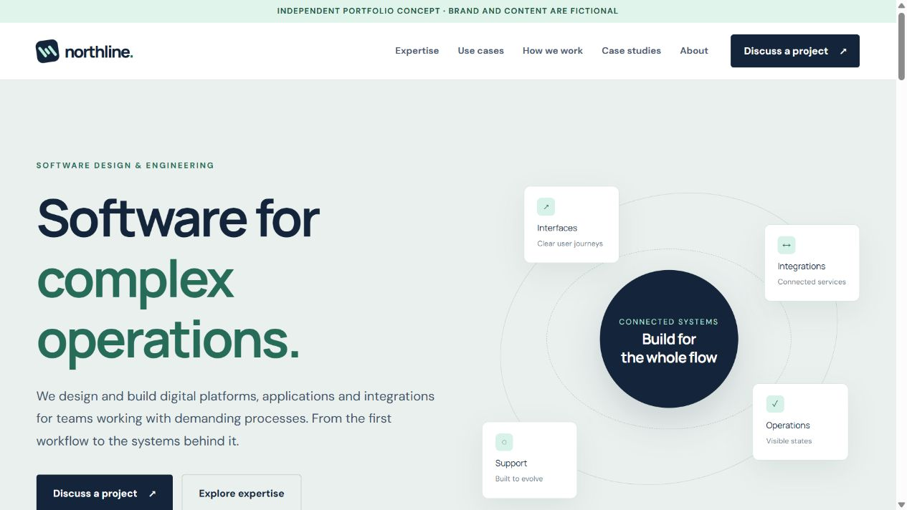
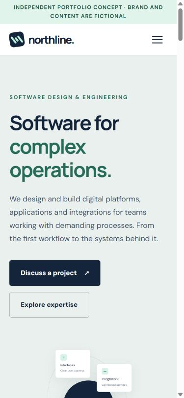

# Northline Studio — corporate website concept

An independent, fictional portfolio prototype for a software engineering company serving complex digital operations. The concept demonstrates a multi-page B2B site without presenting the company as a bank or other regulated financial provider.



<details><summary>Mobile preview</summary>



</details>

## What is included

- Seven linked sections: Home, Expertise, Use cases, How we work, Case studies, About, Contact.
- Responsive desktop and mobile layouts, keyboard navigation, visible focus, and reduced-motion support.
- A contact form with client-side validation and success state. **It does not send or store data.**
- Illustrative case-study placeholders explicitly marked as fictional, with no invented client names or results.
- Basic metadata and a small SVG favicon.

## Run locally

No build step is required. Open `index.html` in a modern browser, or run any static file server in this directory:

```sh
python -m http.server 4188
```

Then open <http://127.0.0.1:4188/>. Python is only an optional local server; the site itself uses HTML, CSS and JavaScript.

## Before a production launch

Replace the fictional identity, text, case studies and legal details with approved company material. Connect the form to a secure backend with server-side validation and anti-spam. Add a CMS, editable SEO fields, sitemap, analytics and legally reviewed policies as required. A language switch should be added when translated content exists.

The prototype intentionally avoids claims about licenses, client results, locations or partnerships.
